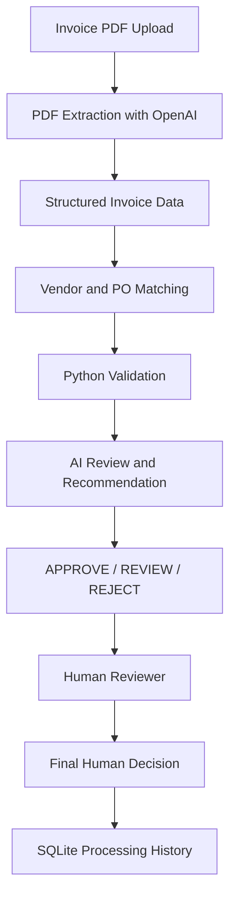

# 📄 AI Invoice Processor

### AI-Powered Accounts Payable Automation with Human-in-the-Loop Review

<p align="center">
  
  
  
  
  
</p>

<p align="center">
  <strong>Transform invoice PDFs into structured, explainable payment recommendations.</strong>
</p>

<p align="center">
  <a href="https://github.com/Ilham6703/PS1-Invoice-Processor">GitHub Repository</a>
  ·
  <a href="https://ps1-invoice-proceappr-vv.streamlit.app/">Live Demo</a>
</p>

---

## 📌 Overview

**AI Invoice Processor** is an AI-assisted Accounts Payable (AP) application that automates key steps in invoice processing, from extracting invoice information to matching purchase orders, validating financial data, and generating explainable recommendations.

Built with Python, Streamlit, and the OpenAI API, the system combines AI-based document understanding with deterministic Python validation and structured business data.

Rather than relying entirely on an AI-generated decision, the application uses validation checks to identify issues and presents its recommendation to a human reviewer, who can make the final approval or rejection decision.

### 🎯 Problem Statement

Traditional invoice processing often involves manually reviewing PDFs, locating purchase orders, checking vendor information, verifying totals, and identifying duplicate or inconsistent invoices.

This project addresses those challenges through an integrated workflow that aims to make invoice review more consistent, traceable, and efficient.

### ✨ Key Highlights

- **PDF invoice extraction:** Extract structured information from invoice documents using an OpenAI model.
- **Purchase order matching:** Retrieve vendor, purchase order, and purchase order line details from a structured Excel workbook.
- **Financial validation:** Check extracted data, invoice arithmetic, and duplicate invoices.
- **AI-assisted review:** Generate an `APPROVE`, `REVIEW`, or `REJECT` recommendation with supporting findings.
- **Human-in-the-loop decisions:** Allow reviewers to approve or reject invoices independently of the AI recommendation.
- **Processing history:** Store invoice processing records and reviewer decisions using SQLite.
- **Explainable findings:** Present reasons and evidence for issues identified during processing.

---

## 🚀 Live Demo

**Try the application:** [Open AI Invoice Processor](https://YOUR-STREAMLIT-APP-URL.streamlit.app)

> Replace the placeholder URL above with your actual Streamlit Community Cloud URL before publishing this README.

The deployed application requires an internet connection and a configured OpenAI API key for AI-powered processing.

---

## 🏗️ System Architecture



### 🔄 Invoice Processing Workflow

| Step | Component | Responsibility |
|---|---|---|
| 1 | Invoice upload | Accept an invoice PDF through the Streamlit interface. |
| 2 | AI extraction | Extract invoice identifiers, vendor details, dates, totals, taxes, and line items. |
| 3 | Data matching | Retrieve relevant vendor records, purchase orders, and PO line items from the workbook. |
| 4 | Python validation | Validate structured data, financial arithmetic, and exact duplicates. |
| 5 | AI review | Evaluate the available evidence and generate a recommendation with findings. |
| 6 | Human review | Let the reviewer approve or reject the invoice and optionally add a note. |
| 7 | Audit history | Save processing information and reviewer decisions in SQLite. |

The system separates document extraction, deterministic validation, AI review, and human decision-making so that each stage has a defined responsibility.

---

## 🧠 Decision Recommendations

The application produces one of three recommendations.

| Recommendation | Meaning |
|---|---|
| 🟢 `APPROVE` | The available evidence supports approval and no blocking issue has been identified. |
| 🟠 `REVIEW` | Additional human investigation is required because of an inconsistency, unresolved matching issue, or insufficient evidence. |
| 🔴 `REJECT` | A rejection condition has been identified, such as an exact duplicate or a confirmed vendor Tax ID mismatch. |

These are **AI recommendations**, not automatic final payment decisions. The human reviewer retains control over the final approval or rejection.

### 🔍 Validation and Review

The system combines deterministic checks with AI-assisted analysis.

**Python validation**

- Structured invoice schema validation.
- Invoice subtotal, tax, and total arithmetic validation.
- Exact duplicate detection using invoice identity information.
- Vendor Tax ID comparison when the relevant information is available.

**AI-assisted review**

- Invoice and purchase order consistency.
- Semantic comparison of invoice descriptions with PO line items.
- Missing purchase order references and insufficient evidence.
- Partial or split invoice scenarios.
- Potential over-billing and repeated invoice submissions.
- Bundled line items that cannot be safely reconciled.
- Explanations and findings that help a reviewer understand the recommendation.

Financial validation and matching depend on the information available in the invoice and reference data. Missing information is not automatically treated as a mismatch.

---

## 🛠️ Technology Stack

| Technology | Purpose |
|---|---|
| Python | Core application logic and orchestration |
| Streamlit | Interactive web interface |
| OpenAI API | AI-assisted PDF extraction and invoice review |
| Pydantic | Structured data models and schema validation |
| Pandas | Structured tabular data handling |
| OpenPyXL | Excel workbook access |
| PyMuPDF | PDF processing |
| SQLite | Local processing history and reviewer decisions |
| python-dotenv | Local environment variable configuration |

---

## ⚙️ Getting Started

### Prerequisites

Before running the project, install:

- Python compatible with the project's dependencies.
- Git.
- An OpenAI API key with API access and available billing or credits.

### 1. Clone the repository

```bash
git clone https://github.com/Ilham6703/PS1-Invoice-Processor.git
cd PS1-Invoice-Processor
```

### 2. Create a virtual environment

**Windows PowerShell**

```powershell
python -m venv .venv
.\.venv\Scripts\Activate.ps1
```

**macOS / Linux**

```bash
python -m venv .venv
source .venv/bin/activate
```

### 3. Install dependencies

```bash
python -m pip install --upgrade pip
pip install -r requirements.txt
```

### 4. Configure the OpenAI API key

Create a `.env` file in the project root:

```env
OPENAI_API_KEY=your_openai_api_key_here
```

Replace the placeholder with your own API key.

**Security:** Never commit `.env` or publish your API key. The repository's `.gitignore` should exclude secrets.

For Streamlit Community Cloud, configure `OPENAI_API_KEY` in the application's Secrets settings and ensure the application reads the configured secret correctly.

### 5. Run the application

From the project root, execute:

```bash
streamlit run app/main.py
```

Streamlit will display a local URL in the terminal. Open that URL in your browser to use the application.

---

## 🖥️ Using the Application

1. Open the Streamlit application.
2. Upload an invoice PDF.
3. Select **Process Invoice**.
4. Review the extracted invoice details.
5. Inspect the matched vendor and purchase order.
6. Examine validation results, the AI recommendation, and its supporting findings.
7. Choose the final human decision: approve or reject.
8. Review the processing history to inspect previously processed invoices and reviewer decisions.

The application is designed to make the processing steps and supporting evidence visible rather than presenting only a final label.

---

### Test Scenarios

The invoice dataset covers scenarios including:

- Standard invoice processing.
- Tax-heavy layouts and missing Tax ID information.
- Multiple invoice line items.
- Invoice amounts outside purchase order tolerance.
- Partial and split invoice billing.
- Potential duplicate submissions and over-billing.
- Invoices without a PO reference.
- Bundled invoice line items.
- Vendor Tax ID mismatches.
- Invoice arithmetic inconsistencies.
- Invoice amounts within tolerance.

The test runner compares actual recommendations against expected decisions configured for the test scenarios.

---

## 🔮 Future Improvements

Potential extensions include:

- Persistent managed database storage for hosted deployments.
- Additional document layout and extraction tests.
- Broader automated regression tests for split billing and bundled items.
- Improved review analytics and reporting.
- More extensive evaluation of extraction and recommendation quality.

These are potential future enhancements, not claims about features already implemented.

---

## 👨‍💻 Author

**ILHAM KHAN**

AI-assisted invoice processing project developed to demonstrate document understanding, structured data validation, purchase order matching, explainable AI recommendations, and human-in-the-loop review.

- GitHub: [@Ilham6703](https://github.com/Ilham6703)
- Project Repository: [PS1-Invoice-Processor](https://github.com/Ilham6703/PS1-Invoice-Processor)

---

<p align="center">
  <strong>AI-assisted processing. Evidence-based review. Human-controlled decisions.</strong>
</p>
